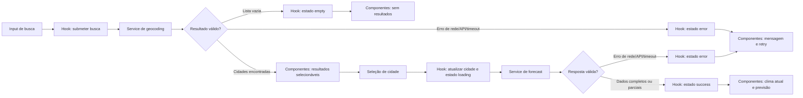

# Plano Técnico — Weather App

## Architecture

Aplicação cliente React, sem backend próprio, organizada em quatro camadas com dependências em uma direção: apresentação → orquestração/estado → acesso a dados; funções puras em `lib` são reutilizadas sem depender das demais camadas.

```text
components/                 apresentação, acessibilidade, eventos
  ↓ props e callbacks
hooks/useWeatherApp         estado da tela, fluxo e concorrência
  ↓ chama
services/openMeteoService   HTTP, query params e transporte
  ↓ usa funções puras
lib/                        parsing/validação, mapeamento e formatação
  ↓                       ↑
types/weather.ts       DTOs das APIs
            ↑
         Open-Meteo APIs
```

`components` não acessa rede nem conhece DTOs Open-Meteo. `hooks` coordena estados e chama contratos de `services`, sem conter parsing ou regras meteorológicas. `services` constrói e executa requisições, transforma falhas de transporte em erros tipados e delega validação/mapeamento a `lib`. `lib` contém funções determinísticas sem efeitos colaterais. `types` define contratos internos compartilhados, sem importar UI ou serviços. Não adicionar servidor, store global ou biblioteca de data sem necessidade demonstrada. A atribuição ao provedor fica na apresentação e segue os termos confirmados antes do lançamento. Rastreia FR-01 a FR-07 e NFR-06.

## Tech Stack

- React 19 e TypeScript strict, já configurados no projeto, para UI e contratos tipados.
- Vite para desenvolvimento e build; Tailwind CSS 3 para estilos responsivos já previstos pelo projeto.
- `fetch`, `URLSearchParams` e `AbortController` nativos para chamadas, encoding e timeout, sem dependência HTTP adicional.
- `Intl.DateTimeFormat` com `pt-BR` para datas e horas; datas meteorológicas são interpretadas no fuso retornado pela API.
- Vitest, Testing Library e Playwright para testes; Biome para lint e formatação.
- Sem segredo no cliente e sem chave de API: o Open-Meteo não exige autenticação para os endpoints definidos.

Os limites de 100 caracteres, 10 resultados, ausência de persistência da unidade, campos meteorológicos parciais e timeout de 8 s são baselines propostos na spec; implementá-los como valores centralizados, fáceis de ajustar após aprovação.

## Project Structure

Estrutura proposta para a implementação, pois `src/` ainda não existe:

```text
src/
  main.tsx
  App.tsx
  components/
    SearchForm.tsx
    CityResults.tsx
    CurrentWeather.tsx
    ForecastList.tsx
    UnitToggle.tsx
    QueryStatus.tsx
    Attribution.tsx
  hooks/
    useWeatherApp.ts
  services/
    openMeteoService.ts
  types/
    weather.ts
  lib/
    parseGeocodingResponse.ts
    parseForecastResponse.ts
    mapWeatherCode.ts
    formatWeather.ts
    convertTemperature.ts
tests/
  unit/
  e2e/
  setup.ts
```

`App.tsx` apenas compõe a tela e conecta `useWeatherApp` a componentes por props/callbacks. Cada componente cuida de uma parte visual e acessível. `useWeatherApp` coordena estado, submissão e descarte de respostas obsoletas. `openMeteoService` é o único módulo com URLs, `fetch` e DTOs externos; chama parsers de `lib` para converter `unknown` em modelos internos. As funções em `lib` recebem valores e retornam valores/erros, sem React, rede ou estado global. `types/weather.ts` contém somente tipos compartilhados. Usar os diretórios de testes já referenciados por `vite.config.ts` e `playwright.config.ts`.

## Data Model

Os tipos abaixo são contratos internos normalizados, não espelham toda a resposta externa. Ausência ou dado inválido vira `null`, nunca zero.

```ts
export type Unit = 'celsius' | 'fahrenheit';

export interface City {
  /** ID da localidade no geocoding, quando fornecido. */
  id: number | null;
  /** Nome da cidade retornado pelo geocoding. */
  name: string;
  /** Subdivisão administrativa retornada, quando disponível. */
  admin1: string | null;
  /** País retornado pelo geocoding, quando disponível. */
  country: string | null;
  /** Código ISO do país, quando disponível. */
  countryCode: string | null;
  /** Latitude usada na consulta meteorológica. */
  latitude: number;
  /** Longitude usada na consulta meteorológica. */
  longitude: number;
}

export interface CurrentWeather {
  /** Horário local de `current.time`. */
  observedAt: string | null;
  /** `current.temperature_2m`, normalizada para Celsius. */
  temperatureC: number | null;
  /** `current.apparent_temperature`, normalizada para Celsius. */
  apparentTemperatureC: number | null;
  /** Código WMO de `current.weather_code`. */
  weatherCode: number | null;
  /** `current.relative_humidity_2m`, em porcentagem. */
  relativeHumidity: number | null;
  /** `current.wind_speed_10m`, normalizada para km/h. */
  windSpeedKmh: number | null;
}

export interface ForecastDay {
  /** Data local de `daily.time`, no formato YYYY-MM-DD. */
  localDate: string;
  /** Código WMO de `daily.weather_code`. */
  weatherCode: number | null;
  /** `daily.temperature_2m_min`, normalizada para Celsius. */
  temperatureMinC: number | null;
  /** `daily.temperature_2m_max`, normalizada para Celsius. */
  temperatureMaxC: number | null;
  /** `daily.precipitation_probability_max`, em porcentagem. */
  precipitationProbabilityMax: number | null;
}

export interface WeatherData {
  /** Cidade selecionada para a consulta. */
  city: City;
  /** Fuso IANA retornado pela API com `timezone=auto`. */
  timezone: string;
  /** Horário de conclusão da consulta, em ISO 8601. */
  fetchedAt: string;
  /** Condições atuais normalizadas. */
  current: CurrentWeather;
  /** Cinco dias locais em ordem; posições sem dados mantêm valores nulos. */
  forecast: [ForecastDay, ForecastDay, ForecastDay, ForecastDay, ForecastDay];
  /** Indica se algum campo ou dia está indisponível. */
  isPartial: boolean;
}

export type RequestErrorKind = 'network' | 'http' | 'timeout' | 'invalid-response';

export interface RequestError {
  kind: RequestErrorKind;
  /** HTTP status, quando houve resposta HTTP não bem-sucedida. */
  statusCode?: number;
}

export type AsyncState<T> =
  | { status: 'idle' }
  | { status: 'loading' }
  | { status: 'success'; data: T }
  | { status: 'empty' }
  | { status: 'error'; error: RequestError };
```

`City.id` e metadados administrativos podem faltar na resposta; coordenadas precisam ser finitas para consultar a previsão. Os modelos internos usam Celsius como unidade canônica; `Unit` controla somente a apresentação. `WeatherData.forecast` é uma tupla de cinco posições locais, inclusive placeholders para datas/dados indisponíveis. O mapeamento WMO para rótulos pt-BR é centralizado; um código desconhecido não deve quebrar a renderização e deve ser tratado como condição indisponível.

## Data Flow

1. O usuário digita a consulta; ao enviar, o app remove espaços externos, normaliza Unicode NFC e valida vazio/limite. A busca não ocorre a cada tecla.
2. `useWeatherApp` inicia uma requisição de geocoding. O service codifica query parameters com `URLSearchParams`, valida a resposta e devolve `City[]`; lista vazia vira estado `empty`.
3. A UI apresenta resultados selecionáveis sem seleção automática. Selecionar uma cidade limpa imediatamente o clima anterior e inicia a consulta meteorológica.
4. O service monta a solicitação de previsão, valida os campos e converte os DTOs em `WeatherData`. Dados individuais inválidos viram `null`; ausência de dia mantém a posição no array de cinco datas.
5. O hook publica `success` com `isPartial` quando aplicável, ou os estados `error`/`empty`. A UI formata datas/horas no fuso da resposta e mostra campos indisponíveis conforme AC-05.
6. Alternar unidade deriva valores Fahrenheit da temperatura canônica Celsius; não repete a chamada nem persiste preferência. Nova carga da página inicia em Celsius.



## External APIs

As duas APIs são GET via HTTPS e não exigem credenciais. Montar query strings com `URLSearchParams`; os exemplos abaixo mostram apenas campos relevantes.

### Geocoding

- **URL:** `https://geocoding-api.open-meteo.com/v1/search`
- **Parâmetros:** `name` recebe a busca normalizada; `count=10` limita os resultados conforme o baseline da spec; `language=pt` solicita nomes em português; `format=json` fixa o formato.
- **Exemplo de chamada:**

```text
https://geocoding-api.open-meteo.com/v1/search?name=S%C3%A3o+Paulo&count=10&language=pt&format=json
```

- **Resposta resumida:**

```json
{
  "results": [
    {
      "id": 3448439,
      "name": "São Paulo",
      "latitude": -23.5475,
      "longitude": -46.6361,
      "country_code": "BR",
      "admin1": "São Paulo",
      "country": "Brasil"
    }
  ],
  "generationtime_ms": 0.2
}
```

- **Mapeamento:** cada item de `results` vira `City`: `id`, `name`, `admin1`, `country` e `country_code` mapeiam para os campos homônimos/camelCase; `latitude` e `longitude` permanecem numéricos. Converter metadados ausentes para `null`; descartar coordenadas não finitas. Ausência ou lista vazia em `results` representa nenhum resultado, enquanto HTTP inválido ou JSON incompatível é erro.

### Forecast

- **URL:** `https://api.open-meteo.com/v1/forecast`
- **Parâmetros:** `latitude` e `longitude` vêm do `City` selecionado; `current=temperature_2m,apparent_temperature,weather_code,relative_humidity_2m,wind_speed_10m`; `daily=weather_code,temperature_2m_min,temperature_2m_max,precipitation_probability_max`; `timezone=auto`; `forecast_days=5`; `temperature_unit=celsius`; `wind_speed_unit=kmh`.
- **Exemplo de chamada:**

```text
https://api.open-meteo.com/v1/forecast?latitude=-23.5475&longitude=-46.6361&current=temperature_2m%2Capparent_temperature%2Cweather_code%2Crelative_humidity_2m%2Cwind_speed_10m&daily=weather_code%2Ctemperature_2m_min%2Ctemperature_2m_max%2Cprecipitation_probability_max&timezone=auto&forecast_days=5&temperature_unit=celsius&wind_speed_unit=kmh
```

- **Resposta resumida:**

```json
{
  "timezone": "America/Sao_Paulo",
  "current_units": {
    "temperature_2m": "°C",
    "apparent_temperature": "°C",
    "relative_humidity_2m": "%",
    "wind_speed_10m": "km/h"
  },
  "current": {
    "time": "2026-09-30T09:00",
    "temperature_2m": 18.5,
    "apparent_temperature": 18.1,
    "weather_code": 3,
    "relative_humidity_2m": 72,
    "wind_speed_10m": 8.4
  },
  "daily": {
    "time": ["2026-09-30", "2026-10-01", "2026-10-02", "2026-10-03", "2026-10-04"],
    "weather_code": [3, 2, 61, 3, 1],
    "temperature_2m_min": [15.1, 16.0, 17.2, 16.4, 15.8],
    "temperature_2m_max": [23.0, 24.2, 21.5, 22.4, 24.0],
    "precipitation_probability_max": [10, 20, 70, 30, 10]
  }
}
```

- **Mapeamento para o modelo:** `City` é o resultado de geocoding selecionado. Criar `WeatherData.timezone` de `timezone`, `fetchedAt` com o relógio do cliente em ISO 8601 e `current` com `current.time` → `observedAt`, os valores de `current.*` → campos correspondentes de `CurrentWeather`. Validar unidades por `current_units` e manter `temperatureC`, `apparentTemperatureC` em °C e `windSpeedKmh` em km/h.
- `daily` contém arrays paralelos. Para cada índice `i` de `daily.time`, criar `ForecastDay`: `time[i]` → `localDate`, e os valores do mesmo índice de `weather_code`, `temperature_2m_min`, `temperature_2m_max` e `precipitation_probability_max` → campos correspondentes. Preservar a ordem local; construir exatamente cinco posições e usar `null` para valor ausente/inválido. `WeatherData.isPartial` é `true` se qualquer campo/dia exigido estiver indisponível.
- **Validação:** exigir objeto `current`, `daily.time` e arrays pedidos; verificar comprimentos, finitude e domínios antes de normalizar. Ausência de um valor individual produz dado parcial; envelope inválido é erro estrutural conforme AC-06. Usar `current.time` e `timezone` da resposta, nunca o fuso do dispositivo.
- A atribuição visível e o texto sobre limitações da previsão devem seguir os termos vigentes do provedor, a confirmar antes do lançamento.

## State Management

O estado da tela vive localmente em `useWeatherApp`, usando `useReducer` para transições explícitas; não há store global. Manter recursos de busca e clima independentes:

```ts
interface WeatherAppState {
  query: string;
  search: AsyncState<City[]>;
  selectedCity: City | null;
  weather: AsyncState<WeatherData>;
  unit: Unit;
}
```

`AsyncState<T>` tem os estados `idle`, `loading`, `success`, `error` e `empty`. Ambos os recursos começam em `idle`; envio inicia `loading`; resposta válida com dados inicia `success`; geocoding válido sem resultados inicia `empty`; falha de requisição inicia `error`. `empty` é aplicável à busca, não substitui erro de API. Clima parcial continua em `success`, com `WeatherData.isPartial === true` e campos indisponíveis como `null`.

`unit` começa em `celsius` e vive no mesmo estado local; não persiste após recarregar. `WeatherData` mantém temperaturas canônicas em Celsius. Durante a renderização, componentes chamam a função pura de `lib` para derivar Celsius ou Fahrenheit: `°F = (°C × 9/5) + 32`, arredondado ao inteiro mais próximo conforme FR-05. A derivação cobre temperatura atual, sensação térmica e mínimas/máximas; não altera os dados armazenados e não dispara request.

Usar `AbortController` e identificador crescente por recurso. Busca nova mantém os dados climáticos da cidade selecionada; somente resultados da busca mais recente são aplicados. Ao selecionar outra cidade, limpar o clima antigo e iniciar o estado meteorológico em `loading`; somente a resposta da seleção atual pode ser aplicada (FR-06, AC-07). Cancelamento por substituição não é erro nem timeout.

## Error Handling

- **Rede (`network`):** `fetch` rejeitado sem resposta HTTP. Manter a etapa no estado `error`, exibir a mensagem específica de busca ou clima definida em AC-06 e permitir retry manual; não repetir automaticamente.
- **API/HTTP (`http`):** resposta com `response.ok === false`. Registrar o status numérico para diagnóstico e exibir a mensagem genérica da etapa, sem expor corpo/técnicos ao usuário. Não converter falha HTTP em estado `empty`.
- **Timeout (`timeout`):** 8 s por requisição como baseline proposto. Abortar com `AbortController`, encerrar loading e exibir a mensagem de timeout de AC-06. Distinguir esse aborto do cancelamento intencional por requisição mais recente; cancelamento não altera o estado visível nem oferece erro.
- **Resposta estrutural inválida (`invalid-response`):** JSON inválido ou envelope/campos estruturais obrigatórios ausentes. Encerrar loading, usar a mensagem de erro da etapa e permitir retry manual.
- **Resposta parcial:** campo individual ausente, não finito ou fora do domínio vira `null`; manter outros valores válidos, definir `WeatherData.isPartial` e manter o recurso em `success`. Exibir os avisos de AC-05. Umidade/probabilidade fora de 0–100 e velocidade negativa são inválidas; ausência nunca vira zero.
- **Sem resultados (`empty`):** somente resposta válida de geocoding sem localidades; preservar a consulta e mostrar AC-03. Não iniciar forecast.
- **Seleção concorrente:** ao selecionar outra cidade, limpar os dados antigos antes de carregar; falha da nova requisição não pode exibir os dados anteriores sob a cidade nova. Uma busca de texto, sem seleção nova, mantém o clima da cidade atual conforme FR-06.

## Testing Strategy

- **Funções puras (`lib`, Vitest):** cobrir conversão Celsius/Fahrenheit (20, 0, -10 °C), arredondamento e preservação de `null`; validação de domínios; parsing/mapeamento de fixtures Open-Meteo válidas, incompletas e malformadas; códigos WMO; formatação de datas em fusos diferentes. Sem DOM, rede ou mocks.
- **Acesso a dados (`services`, Vitest):** mockar `fetch` para verificar URL/encoding/parâmetros de geocoding e forecast, mapeamento via parsers, lista vazia, HTTP não-2xx, falha de rede, JSON/envelope inválido, timeout e cancelamento. Testes determinísticos nunca dependem do serviço externo real.
- **Orquestração (`hooks`, Vitest + Testing Library):** validar estado inicial e transições `idle → loading → success|empty|error`, sucesso parcial como `success` com `data.isPartial`, retry manual, unidade inicial, seleção de cidade, preservação do clima durante nova busca e descarte de respostas fora de ordem. Substituir services por mocks.
- **Apresentação (`components`, Testing Library):** renderizar e interagir por props/callbacks em `loading`, `error`, `empty` e `success`, além de dados parciais; conferir mensagens pt-BR, foco, teclado, nomes acessíveis e alternância visual de unidade. Não mockar `fetch` diretamente em testes de componente.
- **Fluxos integrados (Playwright):** cobrir busca → resultados → seleção → clima/previsão; input vazio e sem resultados; erro/timeout e retry; resposta parcial; alternância sem nova requisição; fuso do dispositivo divergente; proteção contra resposta fora de ordem.
- **Viewports:** rodar o fluxo principal em desktop e mobile com fixtures interceptadas por `page.route`. Verificar largura de 320 CSS px e dispositivo iPhone configurado, sem rolagem horizontal e com controles utilizáveis por toque. A configuração atual já inclui Chromium desktop e iPhone; Firefox, WebKit e Edge requerem projetos adicionais para cumprir toda a matriz de NFR-03.
- Relacionar casos automatizados a AC-01–AC-09. Complementar com verificação manual WCAG 2.2 AA para leitor de tela, contraste e comportamento de foco (NFR-02).

## Risks & Trade-offs

| Decisão | Escolha do plano | Alternativa considerada e trade-off |
| --- | --- | --- |
| Acesso às APIs | `fetch` nativo no cliente, sem backend. | Proxy/backend centralizaria limites e protegeria futuras credenciais, mas adiciona infraestrutura, custo e latência; não há chave necessária nesta versão. A chamada direta aumenta dependência de CORS, disponibilidade e termos do provedor. |
| Estado da interface | `useReducer` local no hook da tela. | Redux/Zustand/contexto global facilitariam estado compartilhado entre muitas rotas, mas adicionam abstração e dependências sem benefício para uma tela e sem persistência. |
| Cache e requisições | Sem cache persistente ou retry automático; timeout e retry manual explícitos. | React Query/SWR ofereceriam cache, deduplicação e retries, mas poderiam exibir dados obsoletos ou repetir chamadas sem controle, contrariando o contrato atual e adicionando dependência. |
| Modelo e conversão | Guardar temperaturas em Celsius; derivar Fahrenheit na renderização por função pura. | Solicitar as duas unidades ou armazenar valores convertidos duplica dados/requisições e pode causar divergência; conversão derivada mantém uma fonte canônica, ao custo de arredondamento definido pelo produto. |
| Parsing e normalização | DTOs ficam no service; parsers puros em `lib` produzem tipos internos. | Usar diretamente o formato do provedor reduz mapeamento inicial, mas espalha acoplamento ao schema pela UI e torna fixtures/refactors mais frágeis. |
| Datas e fusos | `Intl.DateTimeFormat` e timezone retornado pelo Open-Meteo. | Biblioteca dedicada pode simplificar operações avançadas de calendário, mas acrescenta bundle/dependência; o escopo atual só formata timestamps e datas locais já fornecidos pela API. |
| Testes de API | Fixtures e mocks para Vitest/Playwright. | Chamadas reais verificariam disponibilidade e contrato externo, mas são lentas, não determinísticas e sujeitas a rede/limites; usar apenas como smoke opcional fora da suíte de CI.

Riscos ainda a validar antes do lançamento: termos e atribuição do Open-Meteo, cobertura geográfica prioritária e aprovação dos baselines de busca, campos, timeout, desempenho e disponibilidade definidos na spec.